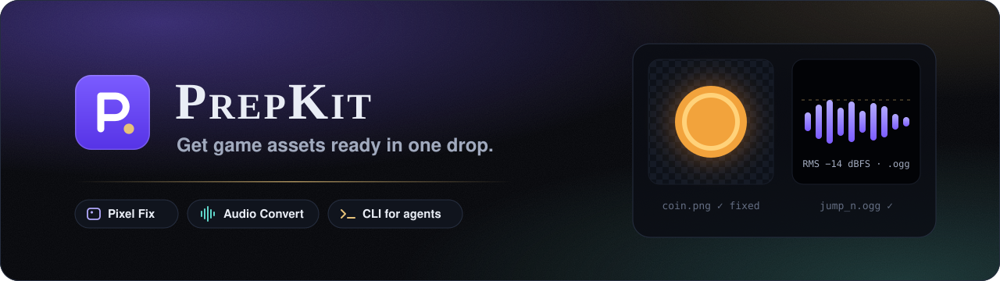
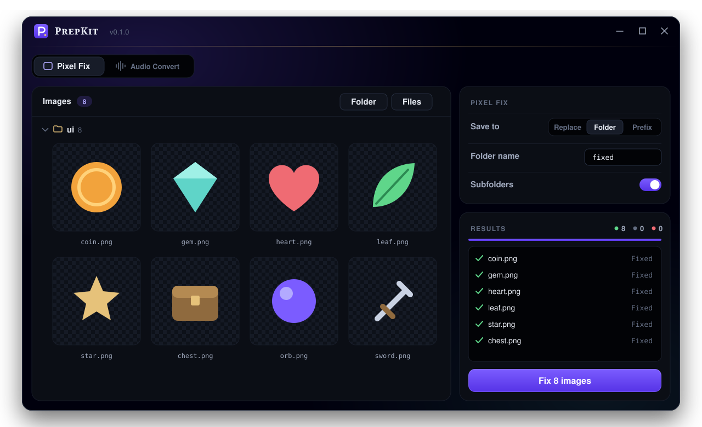
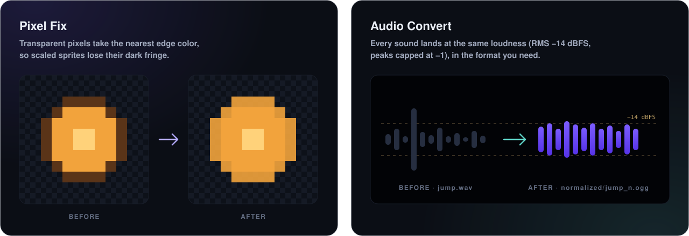

<p align="center">
  
</p>

<p align="center">
  <a href="https://github.com/nyaridev/prepkit/releases/latest"></a>
  
  
  <a href="LICENSE"></a>
</p>

<p align="center">
  <a href="https://github.com/nyaridev/prepkit/releases/latest/download/PrepKit.exe"><b>Download PrepKit.exe</b></a>
  &nbsp;·&nbsp;
  <a href="#command-line">Command line</a>
  &nbsp;·&nbsp;
  <a href="#for-ai-agents">For AI agents</a>
</p>

<p align="center">
  
</p>

A small, fast desktop toolkit (about 13 MB, no installer) for the jobs every game asset needs before it ships. Drop
files or folders, pick the options, press one button. The same tools run from a CLI, so your scripts and AI agents can
use them too.

## Tools

<p align="center">
  
</p>

| Tool | What it does |
|---|---|
| **Pixel Fix** | Fills fully transparent pixels with the nearest edge color, so sprites and icons don't get dark or bright fringes when the engine scales or filters them. Transparency stays the same. Results replace the originals, go into a sub-folder (`fixed/`), or sit next to them with a prefix (`fixed_`). |
| **Audio Convert** | Brings every sound to an RMS (default −14 dBFS) or peak target and saves it to a `normalized/` folder next to the original, optionally converted to another format (`.ogg`, `.mp3`, `.wav`, `.flac`, `.m4a`, `.aac`, `.opus`, `.aiff`, `.wma`). |

More asset-prep tools will join them as tabs.

## Download

Get **`PrepKit.exe`** from [Releases](https://github.com/nyaridev/prepkit/releases) and run it. There's nothing to
install. It needs Windows 10 or 11 (with WebView2, which Windows already ships).

Audio Convert uses **[FFmpeg](https://ffmpeg.org)**:
- If FFmpeg is on your PATH, PrepKit uses it.
- If it isn't, the Audio tab shows a **Download ffmpeg** button. It downloads a build from
  [BtbN/FFmpeg-Builds](https://github.com/BtbN/FFmpeg-Builds), checks its SHA256, puts it in
  `%LOCALAPPDATA%\Programs\ffmpeg`, and adds that folder to your user PATH.

## Using the app

1. Drop files or folders on the window, click the drop area, or use **Folder** / **Files**.
   - Each added folder becomes a collapsible group of the files it contains (with **Subfolders** on, the files in
     its sub-folders too).
   - Images show a preview; switch between list and grid.
   - Remove single files or whole folders you don't want.
2. Pick the options and press the button at the bottom of **Results** (**Fix N images** / **Convert N files**).

PrepKit remembers your options (output mode, targets, format, suffix, view, open tab) between runs, but never the
folders.

## Command line

`prepkit-cli.exe` (also on the Releases page) runs the same tools:

```bash
prepkit-cli pixel-fix "D:\Game\assets\ui" --recursive
prepkit-cli pixel-fix "D:\Game\assets\ui" --output folder --folder fixed
prepkit-cli audio-convert "D:\Game\sfx" --convert ogg
prepkit-cli audio-convert "D:\Game\sfx" --mode peak --target -1
prepkit-cli install-ffmpeg
prepkit-cli --help
```

| Option | Meaning |
|---|---|
| `--recursive` | Pixel Fix: include sub-folders |
| `--output replace\|folder\|prefix` | Pixel Fix: overwrite (default), write into `--folder` (default `fixed`), or next to the original with `--prefix` (default `fixed_`) |
| `--mode rms\|peak` | Audio: RMS (default) or peak normalization |
| `--target <dB>` | Audio: target in dBFS (default -14 for RMS, -1 for peak) |
| `--no-normalize` | Audio: only convert |
| `--convert <format>` | Audio: output format instead of keeping each file's own |
| `--suffix <text>` | Audio: added to output names (default `_n`) |
| `--overwrite` | Audio: replace outputs that already exist |
| `--json` | Print one JSON summary instead of a line per file |

The exit code is `0` when every file worked, and `1` when something failed or no files matched.

## For AI agents

Point your agent at this repo. For example: *"use PrepKit in `D:\Tools\prepkit` for new assets"*. From any folder it
can run:

```bash
D:\Tools\prepkit\prepkit.cmd pixel-fix <image file or folder> --json
D:\Tools\prepkit\prepkit.cmd audio-convert <audio file or folder> --convert ogg --json
```

`prepkit.cmd` uses a built `prepkit-cli.exe`, builds one with `cargo` when Rust is installed, or downloads the latest
release. Agents should read [`AGENTS.md`](AGENTS.md), and ask before running `install-ffmpeg`, because it changes the
user's PATH.

## Build from source

You need Node 22+, pnpm and Rust.

| Command | What |
|---|---|
| `start-dev.bat` | The app with hot reload |
| `build.bat` | `release\PrepKit.exe` and `release\prepkit-cli.exe` |
| `cargo test --workspace` | Rust tests |
| `pnpm check` | Type-check, lint and UI tests |

To publish a release, attach `release\PrepKit.exe` and `release\prepkit-cli.exe` (under exactly those names) to a
GitHub release. `prepkit.cmd` downloads `prepkit-cli.exe` from the latest one.

## Credits

Audio processing is done by [FFmpeg](https://ffmpeg.org), which PrepKit runs but doesn't ship. PrepKit merges
nyaridev's earlier `pixel-fix` and `audio-normalize` tools. MIT licensed.
